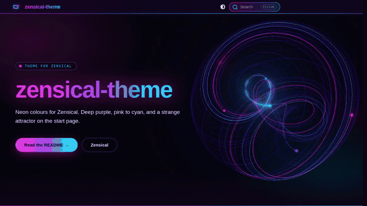

# zensical-theme

Neon (cyberpunk) colours for [Zensical](https://zensical.org/): a glass
header with a pink → purple → cyan hairline, gradient headings, cyan links
that glow pink on hover. Two variants that follow Zensical's colour scheme:
deep purple with bright neon on `slate` (dark), pale lavender with the same
hues deepened for contrast on `default` (light). Colours only, no layout
changes – except for an optional animated hero on the start page (see below).



Zensical has no installable third-party themes. What it has is `custom_dir`,
a folder of template overrides that may also carry assets. This repo is such
a folder: `overrides/main.html` appends one style sheet to Zensical's own,
and `overrides/assets/stylesheets/neon.css` holds the colours. Nothing is
copied into your `docs/`.

## Use it

1. Get the `overrides/` folder next to your `zensical.toml`, for example as a
   submodule or a clone pinned to a commit:

   ```bash
   git submodule add https://github.com/tabee/zensical-theme.git theme
   # or
   git clone https://github.com/tabee/zensical-theme.git theme
   ```

2. Point Zensical at it. Both schemes are styled; one palette is enough,
   two with a toggle let the reader choose:

   ```toml
   [project.theme]
   variant = "modern"
   custom_dir = "theme/overrides"

   [[project.theme.palette]]
   media = "(prefers-color-scheme: dark)"
   scheme = "slate"
   primary = "deep-purple"
   accent = "pink"
   toggle = { icon = "material/brightness-4", name = "Light" }

   [[project.theme.palette]]
   media = "(prefers-color-scheme: light)"
   scheme = "default"
   primary = "white"
   accent = "pink"
   toggle = { icon = "material/brightness-7", name = "Dark" }
   ```

   `primary` and `accent` only matter for what the style sheet does not
   touch; the neon colours themselves come from the style sheet.

   `custom_dir` is resolved relative to `zensical.toml`; an absolute path
   works as well. If you already use `extra_css`, keep it: the override only
   adds a link to the `styles` block, the rest of `base.html` is untouched.

3. `zensical build` (or `serve`). The CSS ends up at
   `assets/stylesheets/neon.css` in the output.

Zensical allows one `custom_dir`. If you already have your own overrides,
take `overrides/assets/` and `overrides/partials/neon-hero.html` into your
folder and merge the blocks from `overrides/main.html` into your `main.html`.

## Start page with animation

Opt-in per site: add a `hero` key to the front matter of your start page
(`index.md` in `docs_dir`). The hero is rendered full width above the page
content, the page's own first heading is hidden (the hero carries the title).

```yaml
---
hero: true
---
```

That already gives you the animation with `site_name` as title and
`site_description` as text. All keys:

```yaml
---
hero:
  eyebrow: Field notes          # optional, small label above the title
  title: My notes               # default site_name
  text: One sentence about it.  # default site_description
  attractor: aizawa             # default aizawa (the sphere); see below
  buttons:                      # optional, the first one is highlighted
    - text: Start
      href: start/              # relative to the site root, or absolute
---
```

The title wraps where it has to. If it contains a hyphen that should not
become a line break, write it as a non-breaking hyphen (`‑`, U+2011), as the
example page does.

What moves: a [strange attractor](https://en.wikipedia.org/wiki/Attractor#Strange_attractor),
drawn with [Three.js](https://threejs.org/) as a dim violet thread with a few
comets racing along it. On the dark scheme they glow through a bloom pass; on
the light scheme the lines multiply into the pale background like ink. The
hero follows the palette toggle live. It orbits slowly and tilts with the
pointer. On wide screens it sits right of the text,
on narrow ones below it. `prefers-reduced-motion` gets a single still frame,
off-screen or in a background tab nothing is rendered, without WebGL the
dark background stays.

`attractor` is a name, `random`, or a list to pick from on every visit:
`aizawa` (sphere), `thomas`, `halvorsen`, `dadras`, `lorenz`. While tuning,
`#attractor=thomas` in the URL wins over the front matter.

Three.js 0.187.0 (MIT) is vendored under
`overrides/assets/javascripts/vendor/three/`, so the page makes no requests to
third parties. About 900 KB are loaded on the start page only; the hero
files stay out of every other page.

## Preview

```bash
uvx zensical serve      # uses zensical.toml and example/ in this repo
```

[`uvx`](https://docs.astral.sh/uv/guides/tools/) runs Zensical in a throwaway
environment, nothing is installed into your Python. Classic way:
`pip install zensical && zensical serve`.

## Updates

Pin a commit or tag and bump it on purpose; a moving branch can change your
site without a commit on your side. Optional: the style sheet also colours
the knowledge graph of [zensical-graph](https://github.com/tabee/zensical-graph)
(v2) through its `--zg-*` variables; without the plugin those rules are inert.

Tested with Zensical 0.0.72.

## License

MIT, see [LICENSE](LICENSE). Three.js is MIT as well, see
`overrides/assets/javascripts/vendor/three/LICENSE`.
